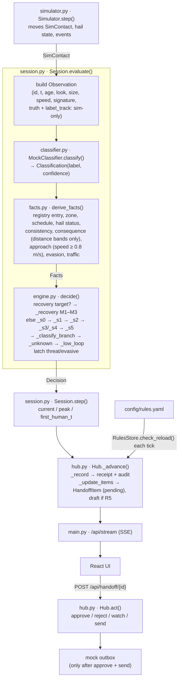

# Pipeline audit

Audit of the contact decision pipeline against the target architecture (fast scan → rules engine → narrow AI layer → ladder). Section 1 is the pipeline **as found** at tag `pre-audit`. Section 2 lists every deviation. Section 3 is the pipeline **after** this audit (tag `v3-audited`).

## 1. As found (`pre-audit`)

Data between stages:

| From → to | Data |
| --- | --- |
| Simulator → Session | `SimContact`: position, heading, speed, size, signature, transponder, hail script, trail, label_track |
| Session → classifier | `Observation`: contact id, t, age, look index, size, speed, signature, plus sim-only `truth` and `label_track` |
| Classifier → facts | `Classification`: fine label (`biologic`, `debris`, `research_auv`, `commercial_rov`, `military_uuv`, `improvised_device`, `unknown`), confidence |
| Facts → engine | `Facts`: category, registry match, schedule, zone, hail status, consistency, consequence level + nearest asset, approach, evasion, traffic, trail |
| Engine → hub | `Decision`: rungs, path (S0–S5 / M1–M3), outcome, reason, checklist, why higher / lower, requires_human, urgency, window |
| Hub → UI | snapshot (contacts, items, budget, new receipts) over SSE |

## 2. Deviations from the target

| # | Target | As found | Where |
| --- | --- | --- | --- |
| D1 | Fast scan returns `debris`, `marine_life`, `known_vehicle`, `unknown` + confidence | Returns seven fine-grained labels. No `known_vehicle` (identity comes from the registry, not the classifier). The engine needs the fine labels for hard triggers (improvised, military), so they cannot simply be replaced | `classifier.py` `MockClassifier.classify`, `rules.yaml` `classes` |
| D2 | Pluggable classifier with a mock | `Classifier` protocol and `MockClassifier` exist; `build_classifier` accepts only `mock`. `Observation` carries sim-only `truth` and `label_track`, which a real sensor would not provide | `classifier.py` |
| D3 | Consequence uses distance, closest point of approach, heading toward assets, closing / loitering / leaving trend | Distance bands only. No CPA, no trend. Heading toward an asset is checked only as a threat trigger (`find_approach`) at ≥ 0.8 m/s within 300 m, so a slow contact drifting into a berth is invisible until it is inside the band | `facts.py` `assess_consequence`, `find_approach` |
| D4 | Jurisdiction settings in config | None. Registry, notice recipient (`modes.*.handoff_target`), hail channel (hard-coded "VHF 16" in the R2 text), notice language (English literals in `Hub._draft`) and response windows are global | `rules.yaml`, `hub.py` `_draft`, `engine.py` `_finish` |
| D5 | Narrow AI layer on ambiguous contacts; may only raise or ask for a second look; guardrails in code; receipts record it | **Does not exist.** No ambiguity flag, no advisor, no fallback, no clamp, no `ai_*` fields | — |
| D6 | R1 is "Look again", max 2, then up one rung | Loop cap and one-rung escalation are correct (`_low_loop`, `Loop.max_second_looks`), but R1 is named "Watch+" | `engine.py` `_low_loop`, `rules.yaml` `modes.security.rungs.R1` |
| D7 | R4/R5 need operator approval, enforced in the backend | Enforced: items are created `pending`, `Hub.act` requires `approve` before `send`, drafts are never sent automatically, outbox is a mock. Gap: the operator is an unauthenticated free string | `hub.py` `act`, `_create_item` |
| D8 | Alert Budget: handled quietly + needs operator = total | `quiet` counts contacts that never needed a person; `need_you` counts *currently pending* items. Once an item is approved, watched or stood down the two no longer add up to `seen` | `hub.py` `budget` |
| D9 | Same seed + same config gives identical decisions | True for the engine. Receipts record `rules_version` (a counter that resets on restart), not a content hash of the config, so a receipt cannot prove which config produced it | `hub.py` `_record` |
| D10 | Thresholds, mappings, zones, schedules, jurisdiction in `rules.yaml`, hot-reloadable | True except jurisdiction (D4). Mock-classifier tuning lives in `scenarios.yaml` (sensor simulation, acceptable) | `rules.py` `RulesStore` |
