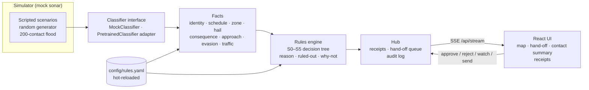

# Quietwater

**The gentlest response that works.** Decision support for a harbor watch officer who has to decide what to do about an unknown autonomous underwater vehicle.

Detection is getting cheap. Handling is not. The default today is "the bang": every sonar hit becomes an alarm, everyone gets called, and the harbor stops. Quietwater sits between *seen* and *handled*. It walks every contact up a ladder — **watch, ask, slow, hold, hand to a person** — and climbs only as far as consequence demands. The low rungs run on their own. Anything that stops work or calls in the Coast Guard waits for a person, arrives as a one-screen package, and is pre-drafted but never sent by the machine.

Built for the Dual-Use Hackathon (InnovateLA at USC, Marine track with NULL Systems). Detection is mocked; the product is the judgment layer and the interface.

---

## What you see

| Screen | What it answers |
| --- | --- |
| **Harbor map** | Every contact, coloured by rung, with trails, zones (critical ones hatched), assets, traffic, and a dashed line to the asset that makes a hand-off urgent. Wheel to zoom, drag to pan. |
| **Needs you** (hand-off) | In two seconds: *What is it?* (label, confidence, size, speed, heading, lat/lon, distance to asset). *What's been ruled out?* (a checklist). *What am I asked to do?* (one recommendation, big **Approve / Reject / Keep watching**, keys A / R / W). Urgency tag, response-window countdown, one-line reason, and a drafted alert you send yourself. |
| **Contact summary** | Shows how many contacts were handled quietly and how many hand-offs currently need a person. |
| **Decision receipts** | Every decision with its one-line reason. Toggle **Why not one rung higher / lower?** for the counterfactual, the S-path, and the full checklist. Export the audit log as JSON or CSV. |
| **Quiet Tuesday** | One switch turns the same engine into lost-research-vehicle recovery for the second customer. |

## Run it

Requirements: Python 3.11+, Node 20+, `make`. Nothing else, no API keys.

```bash
git clone https://github.com/kaushik-lankoji/quietwater.git
cd quietwater
make dev            # UI http://127.0.0.1:5173  ·  API http://127.0.0.1:8000
```

The demo starts on its own with seeded data ("Morning watch"). If port 5173 is taken: `make dev UI_PORT=5174`. If your Python 3.11 is not on the PATH: `make dev PY=/path/to/python3.11`.

| Command | What it does |
| --- | --- |
| `make dev` | Installs dependencies on first run, then starts FastAPI (auto-reload) and Vite together. |
| `make build` | Production build of the UI (`frontend/dist`) and byte-compiles the backend. |
| `make start` | Builds, then serves UI + API from one process on `:8000`. |
| `make test` | Backend unit + API tests, ruff, and a TypeScript type check. |
| `docker compose up` | One container on `:8000`. `config/` and `data/` are mounted, so rules can still reload from disk. |

## Architecture



The same deterministic `Session` (simulator + classifier + engine) runs live inside the hub and in backend replay previews.

### The decision tree


| Rung | Name | Who acts | What happens |
| --- | --- | --- | --- |
| R0 | Watch | automatic | Logged. |
| R1 | Watch+ | automatic | Second look on the next sonar pass. Capped at `loop.max_second_looks`, then up one rung. Never loops forever. |
| R2 | Ask | automatic | Hail on acoustic modem and VHF 16. |
| R3 | Slow | automatic | Advisory to named nearby vessels. |
| R4 | Hold | **person** | Recommend pausing *one* operation at the asset at risk. |
| R5 | Hand off | **person** | Full package; Coast Guard alert pre-drafted. The operator presses send. |

Rules the engine holds to:

- **Confidence alone never escalates.** A 99%-sure unknown far from anything stays at Watch+. Confidence combined with consequence does escalate.
- **The hail gets time.** While a hail is pending (`hail.timeout_s`), nothing above R2 is recommended unless S4 finds a real threat.
- **Urgent hand-offs latch.** Once a contact earns an urgent R5, it doesn't flap back down because it turned around.
- **Hold and Hand off always need a person.** `human_required_from` can be lowered (R3 in a twist), never raised above R4. The schema rejects it.
- **Every decision explains itself:** a one-line reason, the S-path, a ruled-out checklist, and why not one rung higher or lower.

## Changing rules for a twist

Edit `config/rules.yaml` and save. The server picks it up within half a second, shows a "Rules reloaded" toast, records the change in its backend history, and re-decides every contact. An invalid edit is rejected with the reason shown in a banner; the last good rules keep running. The twist API endpoints remain available for scripted previews and changes.

| Twist sounds like… | Touch |
| --- | --- |
| "A new berth / ship / cable / dive is live" | `assets` (and `zones` if it should be critical) |
| "Vehicle X's window changed" / "a new research vehicle" | `registry[...]` |
| "Classifier is less trustworthy at night" | `thresholds.classify_confidence` |
| "Be more cautious around fuel" | `consequence.by_kind.fuel_dock` |
| "A person must approve slow advisories" | `human_required_from: R3` |
| "Different action for medium consequence" | `ladder.unknown_medium_*` |
| "Rename a rung / change the wording" | `modes.security.rungs` |
| "New kind of contact or scenario" | `config/scenarios.yaml` (reloaded on the next scenario load) |

Scenarios, archetypes and the mock classifier's behaviour live in `config/scenarios.yaml`. The harbor drawing is `config/harbor.yaml`.

## Second customer

**USC Wrigley Marine Lab, on a quiet Tuesday.** At 07:31 their REMUS-02 loses comms during a sediment survey. The lab calls the harbor office. The watch officer flips **Quiet Tuesday**. The same sonar feed, classifier, consequence model and ladder now answer a different question: *is this ours, and where is it drifting?*

- R1 **Re-scan** possible matches, capped like any second look.
- R2 **Ping** the acoustic modem.
- R3 **Notify traffic** in its drift path.
- R4 **Hold lane** if it drifts into an operation.
- R5 **Recover**: last fix, drift heading and speed, and ETA to the main channel, handed to the lab's ops desk with a drafted message.

The security track never switches off. An improvised-device signature on Tuesday still goes straight to the Coast Guard package.

Research fleets, survey companies and insurers lose vehicles every season. That makes it a paying, everyday use for the same hardware a port buys for security.

## Responsible use

- **How it could be misused:** as a tracker of legitimate vessels, divers or researchers, or as a way to justify routine interference with them.
- **How it is limited:** it flags only unscheduled autonomous contacts (registered, scheduled, in-zone vehicles and fish or debris stop at Watch), logs every decision with its reason, needs a person's approval for anything that stops work or calls anyone in (one config line, `human_required_from: R1`, extends that to everything above Watch), and never sends an external alert on its own.

## How we used IBM Bob

> _Placeholder for the team: describe where IBM Bob helped (e.g. reviewing the rules engine, generating test cases, drafting twist responses, refactoring), with one concrete example and what you changed afterwards._

## Testing

```bash
make test
```

- `backend/tests/test_engine.py`: every branch of S0–S5, the loop cap (escalates exactly once and never loops again), "confidence alone never escalates", the pending-hail cap, urgent latching, the human floor, and the recovery track.
- `backend/tests/test_rules_and_sim.py`: geometry, schedule windows (including overnight), consequence and approach, evasion detection, deterministic replays, twist ops and validation, every preset validates, and the flood keeps the queue short.
- `backend/tests/test_api.py`: hand-off approve/send/keep-watching, budget, twist preview/apply/history/revert, comment-preserving writes, hot reload with last-good fallback, mode switch, audit export, sim controls.

## API

| Method | Path | Purpose |
| --- | --- | --- |
| GET | `/api/stream` | SSE: `hello` (full state), `tick` (2 Hz), `history` |
| GET | `/api/state` · `/api/config` · `/api/rules` | Snapshot, map + rules + scenarios + presets, raw YAML |
| POST | `/api/sim/control` | `{action: play|pause|step|restart|speed, speed?}` |
| POST | `/api/sim/scenario` · `/api/mode` | Load a scenario (optional seed) · switch security / recovery |
| POST | `/api/handoff/{id}` | `{action: approve|reject|watch|send, operator, note?}` |
| POST | `/api/twist/preview` · `/api/twist/apply` | `{ops | rules | yaml, scenario?, title, note}` |
| GET / POST | `/api/twist/history` · `/api/twist/revert/{id}` | Persisted twist log · revert |
| GET | `/api/audit/export?format=json|csv` | Full audit log |

## Layout

```
config/            rules.yaml (hot-reloaded), scenarios.yaml, harbor.yaml, twist_presets.yaml
backend/app/       rules.py (schema, store, ops) · facts.py · engine.py · classifier.py
                   simulator.py · session.py · twists.py · hub.py · main.py
backend/tests/     engine, rules/sim, API
frontend/src/      App, components (HarborMap, HandoffPanel, WatchSummary, Receipts…)
data/              twist_history.json (created at runtime, git-ignored)
```

See `DEMO_SCRIPT.md` for the 5-minute pitch and `BACKEND_NOTES.md` for what to harden next.
