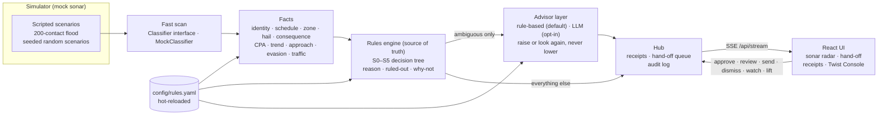
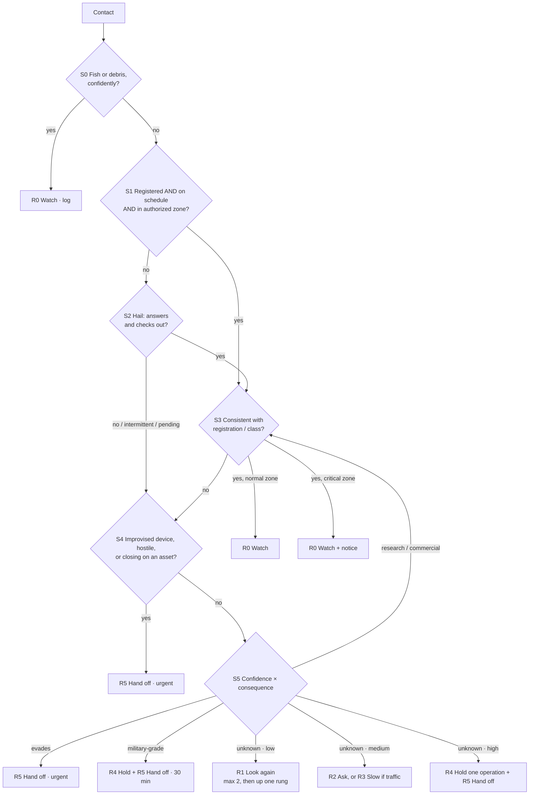
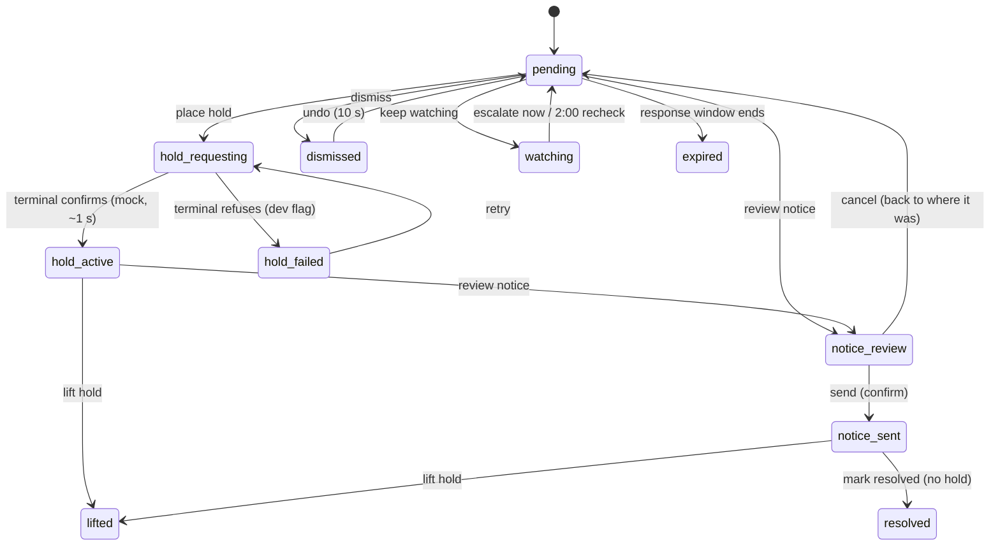

# Quietwater

**The gentlest response that works.** Decision support for a harbor watch officer who has to decide what to do about an unknown autonomous underwater vehicle.

Detection is getting cheap. Handling is not. The default today is "the bang": every sonar hit becomes an alarm, everyone gets called, and the harbor stops. Quietwater sits between *seen* and *handled*. It walks every contact up a ladder — **watch, ask, slow, hold, hand to a person** — and climbs only as far as consequence demands. The low rungs run on their own. Anything that stops work or calls in the Coast Guard waits for a person, arrives as a one-screen package, and is pre-drafted but never sent by the machine.

Built for the Dual-Use Hackathon (InnovateLA at USC, Marine track with NULL Systems). Detection is mocked; the product is the judgment layer and the interface.

---

## What you see

| Screen | What it answers |
| --- | --- |
| **Sonar radar** | The whole screen. The drone sits at the centre; a green pulse sweeps out every 4 s and contacts appear as it passes them. Grey is low risk, yellow medium, red high (red ripples). Hover a contact for its label, confidence, distance, bearing, speed, heading, rung and reason. Click it to open its hand-off (R4/R5) or its decision receipt. |
| **Alert Budget** (top left) | How many contacts need you and how many were handled quietly, plus the scenario picker and harbor clock. Click it to open the hand-off sheet. |
| **Needs you** (hand-off sheet) | The contact is the title, with a one-line summary and a plain "If you approve" list. **Manage activity** asks what should pause: *this operation only* (described in plain words) or *this entire area* (every active operation within `handoff.area_radius_m` of the contact). We recommend one and say why; the operator chooses. Placing the hold sends only a hold request. **Review notice** opens the USCG draft with Send (confirm, no Undo), Edit and Cancel. **Dismiss** (10 s Undo; still tracked, re-alerts if worse) and **Keep watching** (re-checks in 2:00) never send anything. Opens on its own for urgent items. |
| **Watching** (bottom left) | Appears when the operator chooses Keep watching: a collapsible list of watched contacts, soonest re-check first. Click a row to reopen its card. |
| **Graying** | A red contact turns a muted gray-red once its hand-off is dismissed, stood down or acted on, and goes bright red again if it gets worse. |
| **Decision receipts** | Every decision with its one-line reason. Toggle **Why not one rung higher or lower?** for the counterfactual, the S-path, and the full checklist. Export the audit log as JSON or CSV. |
| **Twist Console** | Presets and form editors for thresholds, rungs, zones and schedules, a before/after replay diff, apply live, and a revertible history. |
| **Control dock** | Pause/resume (Space), Replay (R), Flood (F), and Receipts. The Twist Console opens with T. |
| **Dual-use** (top right) | One switch turns the same engine into lost-research-vehicle recovery for the second customer. |

## Run it

Requirements: Python 3.11+, Node 20+, `make`. Nothing else, no API keys.

```bash
git clone https://github.com/kaushik-lankoji/quietwater.git
cd quietwater
make dev            # UI http://127.0.0.1:5173  ·  API http://127.0.0.1:8000
```

The demo starts on its own with seeded data ("Morning watch"). If port 5173 is taken: `make dev UI_PORT=5174`. If your Python 3.11 is not on the PATH: `make dev PY=/path/to/python3.11`.

| Command | What it does |
| --- | --- |
| `make dev` | Installs dependencies on first run, then starts FastAPI (auto-reload) and Vite together. |
| `make build` | Production build of the UI (`frontend/dist`) and byte-compiles the backend. |
| `make start` | Builds, then serves UI + API from one process on `:8000`. |
| `make test` | Backend unit + API tests, ruff, and a TypeScript type check. |
| `docker compose up` | One container on `:8000`. `config/` and `data/` are mounted, so rules can still reload from disk. |

## Architecture



The same deterministic `Session` (simulator + classifier + engine) runs live inside the hub and in backend replay previews.

### The decision tree



| Rung | Name | Who acts | What happens |
| --- | --- | --- | --- |
| R0 | Watch | automatic | Logged. |
| R1 | Look again | automatic | Second look on the next sonar pass. Capped at `loop.max_second_looks`, then up one rung. Never loops forever. |
| R2 | Ask | automatic | Use a compatible acoustic link to hail the vehicle, or call its surface operator on the port's working radio channel. If no link exists, seek an operator through port traffic; this is recorded separately from an ignored hail. AIS can help identify a vessel but is not a hailing channel. |
| R3 | Slow | automatic | Advisory to named nearby vessels. |
| R4 | Hold | **person** | Recommend pausing *one* operation at the asset at risk; the configured local approver decides. |
| R5 | Hand off | **person** | Full package; the jurisdiction's notice is pre-drafted and a person decides whether to send it. |

Rules the engine holds to:

- **Confidence alone never escalates.** A 99%-sure unknown far from anything stays at Look again. Confidence combined with consequence does escalate.
- **The hail gets time.** While a hail is pending (`hail.timeout_s`), nothing above R2 is recommended unless S4 finds a real threat.
- **Urgent hand-offs latch.** Once a contact earns an urgent R5, it doesn't flap back down because it turned around.
- **Hold and Hand off always need a person.** `human_required_from` can be lowered (R3 in a twist), never raised above R4. The schema rejects it.
- **Every decision explains itself:** a one-line reason, the S-path, a ruled-out checklist, and why not one rung higher or lower.
- **Consequence looks ahead.** Distance bands set the base level; if a contact's straight-line course enters an asset's band within `consequence.cpa.horizon_s`, consequence rises (capped at `consequence.cpa.raise_to`). Each decision also carries a closing / leaving / loitering trend.

### The advisor layer (the narrow AI)

The rules engine decides. The advisor only reviews contacts the engine marks **ambiguous** (unknown, low confidence, or unexplained behaviour such as a 3 m "fish"). It can raise a decision by at most `advisor.max_raise` rungs or ask for a second look. It never sees hard triggers (improvised device, hostile, closing fast, evasive, military, high consequence) and it cannot lower anything. Guardrails are in code (`backend/app/advisor.py`), not in a prompt:

- Output is validated strictly and clamped; a negative suggestion becomes 0.
- If the advisor errors, times out or returns invalid output, the rule-based advisor answers instead. If that fails too, the contact goes up one rung: it fails safe, never quiet.
- Answers are cached per contact snapshot and config hash, so a replay or a Twist Console diff gives the same result twice.
- Every call is written to the receipt (`advisor`: inputs, suggestion, applied or clamped, source, error) with `ai_raised_tier` and `ai_reason` on the decision.

The default `advisor.backend: rule` is deterministic, offline and needs no keys. An LLM backend is available but off:

```yaml
advisor:
  backend: llm            # default: rule
  llm: {model: claude-haiku-5-5, api_key_env: ANTHROPIC_API_KEY, timeout_s: 2.5}
```

```bash
export ANTHROPIC_API_KEY=...   # never committed; read from the environment
```

### Jurisdictions

`jurisdiction: la` picks a profile from `jurisdictions:` in `rules.yaml`. A profile sets the registry source (and optionally its own registry), notice recipient, separate acoustic and surface contact paths, port operations/security radio channels, local hold and handoff approvers, security liaison, notice language and response windows. LA, Singapore and an EU (Rotterdam) profile ship as **illustrative examples requiring local review**; switching is one line or a twist (`{"path": "jurisdiction", "value": "eu"}`). The harbor watch officer uses this demo; a Port Facility Security Officer is a separate designated security role under the port's local plan. The ladder is a product workflow, not a claim that the [ISPS Code](https://www.imo.org/en/ourwork/security/pages/solas-xi-2%20isps%20code.aspx) requires these exact rungs. Configure `hail_route: acoustic`, `surface`, or `unavailable` on a scripted contact to exercise each path; the **Contact paths** scenario shows the last two. A missing compatible link does not count as an ignored hail. [AIS is for identification](https://www.imo.org/en/ourwork/safety/pages/ais.aspx), not hailing. Sample radio references: [Singapore MPA](https://www.mpa.gov.sg/port-marine-ops/arrivals-and-departures/vessels-arriving-in-singapore) and [Port of Rotterdam](https://www.portofrotterdam.com/en/contact-harbourmaster/vts-services-and-vhf-communication-procedure). Confirm radio channels, recipients and approval authority with the port before operational use.

## Changing rules for a twist

Edit `config/rules.yaml` and save. The server picks it up within half a second, shows a "Rules reloaded" toast, records the change in its backend history, and re-decides every contact. An invalid edit is rejected with the reason shown in a banner; the last good rules keep running. The twist API endpoints remain available for scripted previews and changes.

| Twist sounds like… | Touch |
| --- | --- |
| "A new berth / ship / cable / dive is live" | `assets` (and `zones` if it should be critical) |
| "Vehicle X's window changed" / "a new research vehicle" | `registry[...]` |
| "Classifier is less trustworthy at night" | `thresholds.classify_confidence` |
| "Be more cautious around fuel" | `consequence.by_kind.fuel_dock` |
| "A person must approve slow advisories" | `human_required_from: R3` |
| "Different action for medium consequence" | `ladder.unknown_medium_*` |
| "Rename a rung / change the wording" | `modes.security.rungs` |
| "We're demoing for Singapore / Rotterdam" | `jurisdiction: singapore` or `eu` |
| "Make the AI more / less eager" | `advisor.raise_at`, `advisor.weights`, `advisor.max_raise`, `advisor.enabled` |
| "New kind of contact or scenario" | `config/scenarios.yaml` (reloaded on the next scenario load) |

Scenarios, archetypes and the mock classifier's behaviour live in `config/scenarios.yaml`. The harbor drawing is `config/harbor.yaml`.

**Generate scenario.** The button at bottom centre never changes which scenario is selected. On Morning watch, Flood, Lost REMUS-02 and the rest it re-rolls that scenario with a new seed: the same contacts and the same story, with new start positions, headings, speeds and timing (the flood's 196 filler contacts follow the seed too). On the Random harbor and Random recovery entries it builds a whole new mix. Replay (R) reproduces the run.

**Random scenarios.** Each seed of a random scenario Each seed chooses a 350–1,300 m watch-sector radius and, independently, a traffic level from clear water (0–2 contacts) to a peak surge (81–200). Contacts and waypoints stay within water inside the watch circle. The mix includes debris, marine life, registered vehicles, unknowns near assets, and sometimes an evasive contact. Position, speed, heading, size, confidence, hail response, registration and harbor clock are randomized. Recovery mode uses the same traffic levels; the lost vehicle appears when its search area falls within the sector. Random harbors always include a contact headed for a red hand-off (an unknown at the fuel dock or a ship, or an evasive one) and the sparsest traffic level has 2–3 contacts, so a red appears within about 10–15 s of sim time. Random recovery usually does too, except when the lost vehicle's search area is outside the sector. The seed shows under the Alert Budget, and Replay (R) reproduces that exact run. The ranges and weights are in `config/scenarios.yaml`. The sector range fits this demo map; larger ports use multiple sectors. Published footprints range from the Port of LA's [87-acre Cabrillo Way Marina](https://portoflosangeles.org/references/news_021219_cabrillo_way_award) to its [3,200 water acres](https://portoflosangeles.org/business/statistics/facts-and-figures?ftag=MSF0951a18), so one fixed harbor radius would be misleading.

**Cost estimates.** The lower-right Watch efficiency panel totals two benefits: officer capacity freed by automatically handling contacts, and paused-operation cost avoided by narrower holds. The configurable manual-review benchmark defaults to two minutes per quietly handled contact; that time is valued at the configured officer hourly rate. It is an opportunity-cost estimate, not payroll removed from an existing shift. Savings and remaining watch cost are also shown per square kilometer of water covered. The operating-cost estimate still combines officers on watch, paused-operation time, and cloud AI calls; it does not subtract freed capacity from wages paid. The default $60/officer-hour, $500/paused-operation-hour, and $0.02/AI-call are demo assumptions in `config/rules.yaml`, not measured harbor rates. No cloud AI calls are made by default.

**Cost & scale.** Open the collapsible panel at the bottom right to see the current scenario's watch footprint, quiet contacts, officer requests, modeled review minutes, staffing recommendation, area-hold footprint, LLM call count, and measured mean decision time. Staffing is the smallest number of operators that can complete the observed requests within their response windows while staying under the configured utilization target. Hold optimization chooses the smallest configured radius that covers the active high-consequence assets and the focus asset, plus a safety buffer; the operator still approves the hold. Potential pause savings are shown in operation-minutes against the 400 m baseline, not dollars. These are scenario estimates, not a validated harbor staffing forecast. Review times, utilization, candidate hold radii and buffer are in `config/rules.yaml`.

## Second customer

**USC Wrigley Marine Lab, on a quiet Tuesday.** At 07:31 their REMUS-02 loses comms during a sediment survey. The lab calls the harbor office. The watch officer flips the **Dual-use** switch. The same sonar feed, classifier, consequence model and ladder now answer a different question: *is this ours, and where is it drifting?*

- R1 **Re-scan** possible matches, capped like any second look.
- R2 **Ping** the acoustic modem.
- R3 **Notify traffic** in its drift path.
- R4 **Hold lane** if it drifts into an operation.
- R5 **Recover**: last fix, drift heading and speed, and ETA to the main channel, handed to the lab's ops desk with a drafted message.

The security track never switches off. An improvised-device signature on Tuesday still goes straight to the Coast Guard package.

Research fleets, survey companies and insurers lose vehicles every season. That makes it a paying, everyday use for the same hardware a port buys for security.

## Responsible use

- **How it could be misused:** as a tracker of legitimate vessels, divers or researchers, or as a way to justify routine interference with them.
- **How it is limited:** it flags only unscheduled autonomous contacts (registered, scheduled, in-zone vehicles and fish or debris stop at Watch), logs every decision with its reason, needs a person's approval for anything that stops work or calls anyone in (one config line, `human_required_from: R1`, extends that to everything above Watch), and never sends an external alert on its own.

## How we used IBM Bob

> _Placeholder for the team: describe where IBM Bob helped (e.g. reviewing the rules engine, generating test cases, drafting twist responses, refactoring), with one concrete example and what you changed afterwards._

## Hand-off states

Every R4/R5 decision becomes a hand-off item. Engine decisions never change here; the item only records what a person authorised. The table lives in `backend/app/handoff.py` and is enforced in the backend (illegal moves return 409).



- **Place hold** (the `approve` action) needs `scope: "operation" | "area"` and sends only a hold request (mocked, logged in `hold_requests` with scope, targets and the recommended scope). It never sends the external notice. The recommendation is area when 2+ operations are in range, or the contact is urgent, or closing on a high-consequence asset; otherwise operation. The operator can always choose either.
- **Send** needs `confirm: true` and only works from `notice_review`. It writes to the mock outbox; nothing is transmitted.
- An active hold ends only by **Lift hold**. When its 30:00 runs out it stays in place and offers **Extend**.
- **Expired** pages the backup officer on screen only. A late operator can still act on it.
- Every transition writes an audit entry and a decision receipt (`kind: "handoff"`), and the Alert Budget recounts from item states.
- Timings live in `rules.yaml` → `handoff` (`hold_s`, `undo_s`, `mock_hold_delay_s`) and `alert_budget.keep_watching_snooze_s`.
- To show the failed-hold state, start the API with `QUIETWATER_DEV=1` and `POST /api/dev/mock-hold {"fail": true}`, or start it with `QUIETWATER_MOCK_HOLD_FAIL=1`.

## Testing

```bash
make test
```

- `backend/tests/test_engine.py`: every branch of S0–S5, the loop cap (escalates exactly once and never loops again), "confidence alone never escalates", the pending-hail cap, urgent latching, the human floor, and the recovery track.
- `backend/tests/test_rules_and_sim.py`: geometry, schedule windows (including overnight), consequence and approach, evasion detection, deterministic replays, twist ops and validation, every preset validates, and the flood keeps the queue short.
- `backend/tests/test_handoff.py`: every hand-off transition, every illegal move from every state (refused, nothing changes), the mock hold and its failure, send confirm, edit, undo window, keep-watching recheck, expiry paging, receipts and budget per transition, and that dismiss / keep watching never send anything.
- `backend/tests/test_api.py`: hand-off approve/send/keep-watching, budget, twist preview/apply/history/revert, comment-preserving writes, hot reload with last-good fallback, mode switch, audit export, sim controls.
- `backend/tests/test_advisor.py`: the advisor never lowers a decision (600 random cases), never touches hard triggers, clamps, falls back on error / timeout / malformed output / missing key, fails safe when everything fails, caps advisor second looks, and caches per snapshot and config.
- `backend/tests/test_pipeline.py`: CPA and trend, R4/R5 only by operator approval through the API, no alert ever sent automatically, hot reload changing live decisions with a matching before/after diff, jurisdiction profiles, flood speed and budget totals, dual-use, and replay determinism even with a noisy model.
- `backend/tests/test_randomizer.py`: random scenarios are valid, seeded, deterministic and always include low, mid and high risk; Generate keeps the selected scenario (same contacts and story, only details vary).

`PIPELINE_AUDIT.md` traces a contact through every stage, file by file.

## API

| Method | Path | Purpose |
| --- | --- | --- |
| GET | `/api/stream` | SSE: `hello` (full state), `tick` (2 Hz), `history` |
| GET | `/api/state` · `/api/config` · `/api/rules` | Snapshot, map + rules + scenarios + presets, raw YAML |
| POST | `/api/sim/control` | `{action: play|pause|restart|speed, speed?}` |
| POST | `/api/sim/scenario` · `/api/mode` | Load a scenario (`{name, seed?}`; random scenarios use the seed) · switch security / recovery |
| POST | `/api/handoff/{id}` | `{action, operator, note?, body?, confirm?}`; actions: `approve retry review edit cancel send dismiss undo watch escalate lift resolve extend` |
| GET | `/api/handoff/states` | The state table: states, legal moves, system moves |
| POST | `/api/twist/preview` · `/api/twist/apply` | `{ops | rules | yaml, scenario?, title, note}` |
| GET / POST | `/api/twist/history` · `/api/twist/revert/{id}` | Persisted twist log · revert |
| GET | `/api/audit/export?format=json|csv` | Full audit log |

## Layout

```
config/            rules.yaml (hot-reloaded), scenarios.yaml, harbor.yaml, twist_presets.yaml
backend/app/       rules.py (schema, store, ops) · facts.py · engine.py · classifier.py
                   simulator.py · session.py · twists.py · hub.py · main.py
backend/tests/     engine, rules/sim, API
frontend/src/      App, radar/ (canvas engine), components (Radar, HandoffSheet, ReceiptsSheet, TwistConsole…), styles/tokens.css
data/              twist_history.json (created at runtime, git-ignored)
```

See `DEMO_SCRIPT.md` for the 5-minute pitch and `BACKEND_NOTES.md` for what to harden next.
